# The Leaky Pipeline - Python, Kafka & MongoDB on EKS

[](https://github.com/Telsek/python-kafka-mongo/actions/workflows/ci.yml) [](https://github.com/Telsek/python-kafka-mongo/actions/workflows/release.yml)

A small shop (Harry Potter sweets + LOTR artifacts with DevOps jokes) used to show the full DevOps lifecycle: build, test, release, deploy, scale, break, monitor and tear down - all from git.

You buy something -> the **client** sends it to **Kafka** -> the **api** reads Kafka and saves it in **MongoDB** -> the page shows everything bought. If the api or the database is down, the order waits safely in Kafka and is saved once they're back.

Live (when the cluster is up): <https://shop.mansuraforecast.online>

## Index

- [How it works](#how-it-works)
- [Running it](#running-it)
- [The story in screenshots](#the-story-in-screenshots)
- [CI/CD](#cicd)
- [Tools and why](#tools-and-why)
- [Issues and fixes](#issues-and-fixes)
- [What I'd add for production](#what-id-add-for-production)

## How it works

The AWS network, what runs inside the cluster, and why it's built this way.

### AWS infrastructure

Which AZ gets the 4th node changes per build - the diagram shows one example.

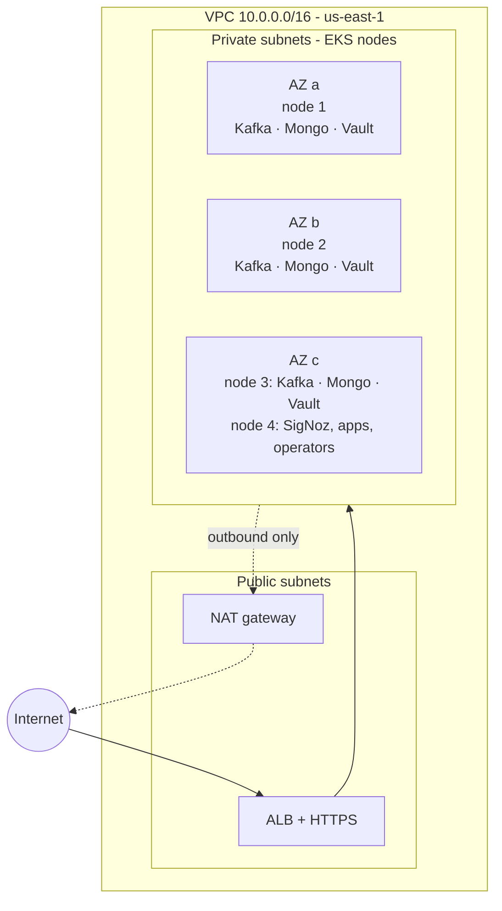

| | |
| --- | --- |
| VPC | 3 AZs. Public subnets (10.0.1-3.0/24) hold only the ALB and the NAT. Nodes and pods live in private subnets (/20 each - every pod gets a VPC IP) |
| NAT | One for all AZs - saves cost. Tradeoff: if its AZ goes down, nodes lose outbound internet - running pods keep working, but new images can't be pulled and calls to AWS (e.g. Vault unlocking with KMS) fail |
| Nodes | 4 x m7i-flex.large (2 vCPU / 8 GB) - the largest type on the AWS free plan. 32 GB total, ~24.5 GB requested |
| Spread | Kafka, Mongo and Vault each run 3 copies, one per AZ. Losing an AZ still leaves 2 of 3 - a majority, so they keep working |
| EKS API | Public, but only reachable from my IP (`admin_cidrs`). Trivy flags it; accepted in `.trivyignore` with the reason |

<details>
<summary>Node sizing - memory per node</summary>

Memory requested per node (planning estimate, example layout). Each node has 8 GB.

| Node | Main pods | Memory requested | Node usage |
| --- | --- | --- | --- |
| 1 | Kafka broker (2 GB), Mongo (1 GB), Vault, small pods | 5.4 GB | 68% |
| 2 | Kafka broker (2 GB), Mongo (1 GB), Vault, small pods | 6.1 GB | 76% |
| 3 | Kafka broker (2 GB), Mongo (1 GB), Vault, small pods | 6.4 GB | 80% |
| 4 | SigNoz + ClickHouse (~3 GB), ArgoCD, operators, shop | 6.6 GB | 83% |
| **Total** | | **24.5 GB** | **77% of 32 GB** |

</details>

Kubernetes decides the exact placement at each build; the only fixed rule is one Kafka / Mongo / Vault per AZ. In practice **CPU** turned out to be the tighter limit: reserved CPU was 62-95% per node (see the MongoDB issue below).

### Inside the cluster

The request path, and how changes get in. Boxes inside "Worker nodes" are namespaces.

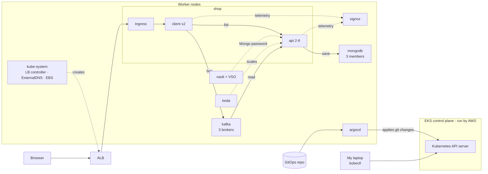

Terraform installs ArgoCD and the AWS add-ons in `kube-system`. ArgoCD installs everything else from the GitOps repo (plus `vault-secrets-operator` and `chaos-mesh`, left out of the diagram). The ALB is created by the LB controller from the Ingress - not by Terraform.

### Why run it in Kubernetes

**Why not plain EC2 machines?** On EC2 every part below would need its own machines, install scripts and failover handling:

<details>
<summary>Component by component</summary>

| Component | On plain EC2 I'd have to | In the cluster |
| --- | --- | --- |
| Kafka (3 brokers) | Install Kafka on 3 machines, set up the quorum, attach a disk to each, restart a dead broker myself | Strimzi builds all 3 from 2 short files, one per AZ, each with its own disk, and restarts a dead one (tested - see [chapter 6](#6-breaking-it-on-purpose)) |
| MongoDB (3 members) | Install 3 servers, start the replica set, create the users, rejoin a member after a failure | The operator builds the replica set and the user. The password comes from Vault |
| Vault (3 pods) | Install 3 servers, join them, set up unlocking | Helm chart: 3 pods, one per AZ, unlock with KMS. A Job does the first-time setup |
| client + api | An Auto Scaling Group and load balancer target group per service | Deployments + one Ingress. KEDA scales the api on Kafka backlog in seconds |
| SigNoz + collectors | A monitoring server, plus an agent installed on every machine | Helm chart. One collector per node, automatically |
| All of it | Ship changes with SSH / Ansible, ~10+ machines | git push -> ArgoCD. Packed onto 4 shared nodes |

</details>

**Why not AWS managed services (MSK, DocumentDB, Secrets Manager, CloudWatch)?** The brief is a showcase for a team that pays me to **run** the platform, so I run the parts myself instead of paying AWS more to run them - each choice is compared in [Tools and why](#tools-and-why). The tradeoff: more for me to run and upgrade. With a real team and budget, MSK and a managed database would be the first things I'd move out.

### Repos

| Repo | Holds |
| --- | --- |
| `python-kafka-mongo` (this one) | App code, Dockerfiles, tests, CI/CD workflows, Terraform, load + chaos tests |
| `python-kafka-mongo-gitops` | What runs in the cluster: ArgoCD apps, Kafka/Mongo/Vault manifests, the shop Helm chart |

This repo:

```text
api/                 api server (FastAPI) + Dockerfile
client/              web page + client server (FastAPI) + Dockerfile
tests/               pytest + Testcontainers; load/buy.js is the k6 test
chaos/               Chaos Mesh experiments
terraform/           AWS + ArgoCD, destroy.sh
.github/workflows/   ci.yml, release.yml
docs/images/         screenshots used below
docker-compose.yml   the first, laptop-only version
CHANGELOG.md         written by release-please
```

## Running it

Needs:

- AWS CLI (logged in), Terraform, kubectl, Docker (for k6)
- Made once, outside Terraform: an S3 bucket for the Terraform state (`providers.tf`), a Route 53 hosted zone for the domain and a wildcard ACM certificate (`variables.tf`)
- `terraform/terraform.tfvars` with `admin_cidrs = ["<your IP>/32"]` (gitignored)

```bash
cd terraform
terraform init
terraform apply -auto-approve   # ~15 min, then ArgoCD needs ~5 more
aws eks update-kubeconfig --name leaky-pipeline --region us-east-1
./destroy.sh                    # ~15 min
```

ArgoCD UI (in its own terminal, it keeps running): `kubectl port-forward -n argocd svc/argocd-server 8443:443`, then <https://localhost:8443>.

The cluster is destroyed at the end of each day and rebuilt from git when needed.

Why a destroy script and not just `terraform destroy`: the load balancer, DNS record and disks are created by Kubernetes controllers, not by Terraform. Terraform doesn't know they exist: the load balancer blocks the VPC from being deleted, and the disks would be left behind, still costing money. The script deletes the apps first, waits until AWS has removed those, then runs `terraform destroy`.

Load + chaos test (cluster up):

```bash
kubectl apply -f chaos/chaos-test.yaml
docker run --rm -i grafana/k6:2.1.0 run - < tests/load/buy.js
```

## The story in screenshots

### 1. It started on a laptop

The first version ran with docker compose. The api was stopped, a buy was made, and it waited in Kafka until the api came back.

| | |
| --- | --- |
| Shop |  |
| api down, buy still accepted |  |
| api back, logs show the save | 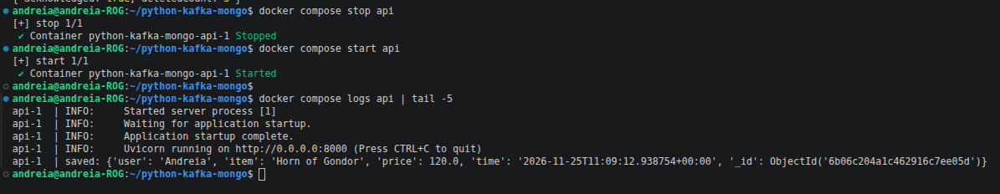 |
| The buy is in the list | 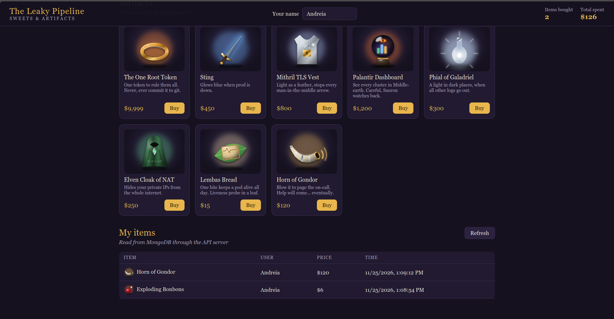 |

### 2. One command builds AWS

`terraform apply` creates 86 resources. ArgoCD comes up and deploys all 15 apps from git - nothing installed by hand.

| | |
| --- | --- |
| Terraform apply |  |
| ArgoCD: 15 apps, all healthy | 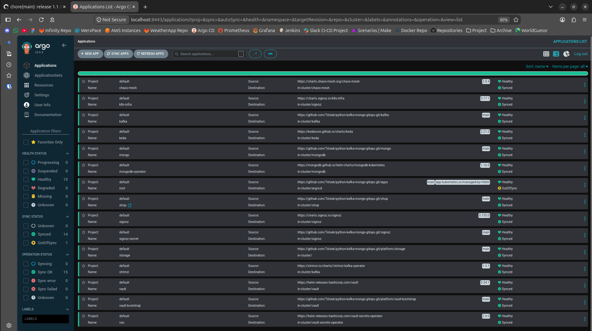 |

### 3. What got deployed

| | |
| --- | --- |
| The shop: deployed by the release bot, KEDA scaler, Ingress, Vault secret | 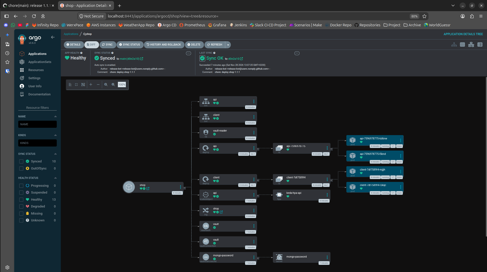 |
| Kafka: 2 small files -> Strimzi builds 3 brokers, 3 disks, the topic (+29 more objects) |  |
| Kafka network: clients connect to one address, 3 brokers behind it |  |
| The Kafka app's 4 pods (3 brokers + topic operator) spread one per node. Each node shows kernel 6.18 (pinned, see [Issues and fixes](#issues-and-fixes)) |  |
| Vault: 3 pods, 3 disks, active + standby | 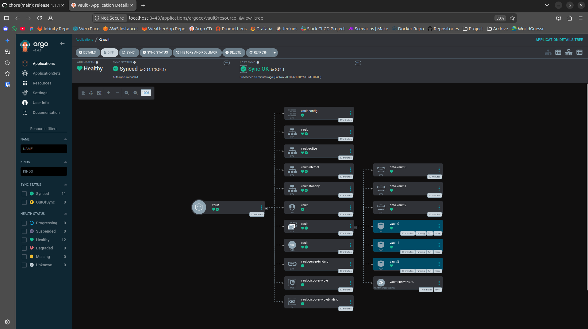 |

### 4. It's live

| | |
| --- | --- |
| Shop on EKS | 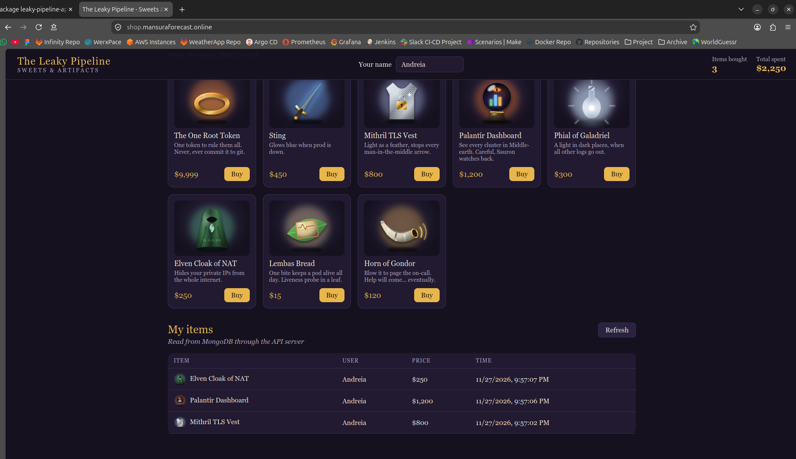 |
| Pods + load balancer address | 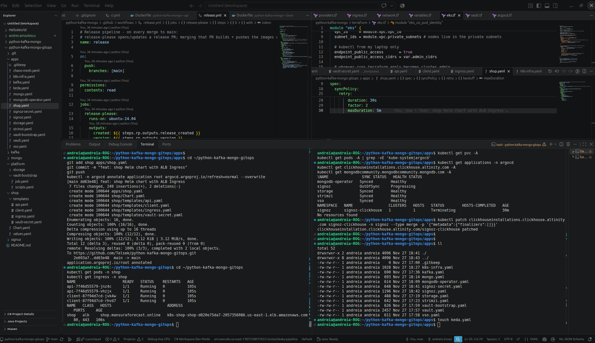 |

### 5. Shipping a change

Every pull request must pass 6 checks. Merging a release builds the images, pushes them to GHCR and writes the new version into the GitOps repo - ArgoCD deploys it.

| | |
| --- | --- |
| 6 required checks |  |
| Release: version -> images -> GitOps |  |

### 6. Breaking it on purpose

Run twice. Each time k6 sends 150-170 buys per second for 3 minutes while Chaos Mesh kills a Kafka broker. The second run also adds 100 ms of network delay to the api, so orders pile up and KEDA has something to scale on.

| | |
| --- | --- |
| First run: a broker was killed and came back | 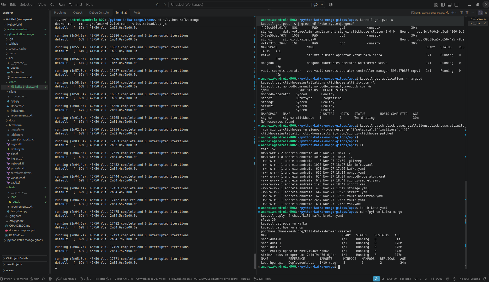 |
| Second run: orders pile up in Kafka -> KEDA scales the api 2 -> 6 | 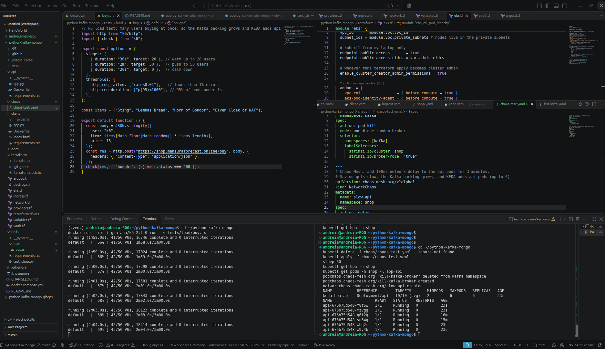 |
| Second run: 31,355 buys, 0 failed |  |

### 7. A real outage

After a rebuild, one of the 3 MongoDB members couldn't start (no node had enough CPU left to reserve). Until it was fixed - about 10 minutes - the api couldn't use the database. 4 buys were made during that time.

| | |
| --- | --- |
| SigNoz home: logs, traces and metrics all active. Services table (bottom right): api error rate 9.57% - the failed "list" calls while Mongo was down | 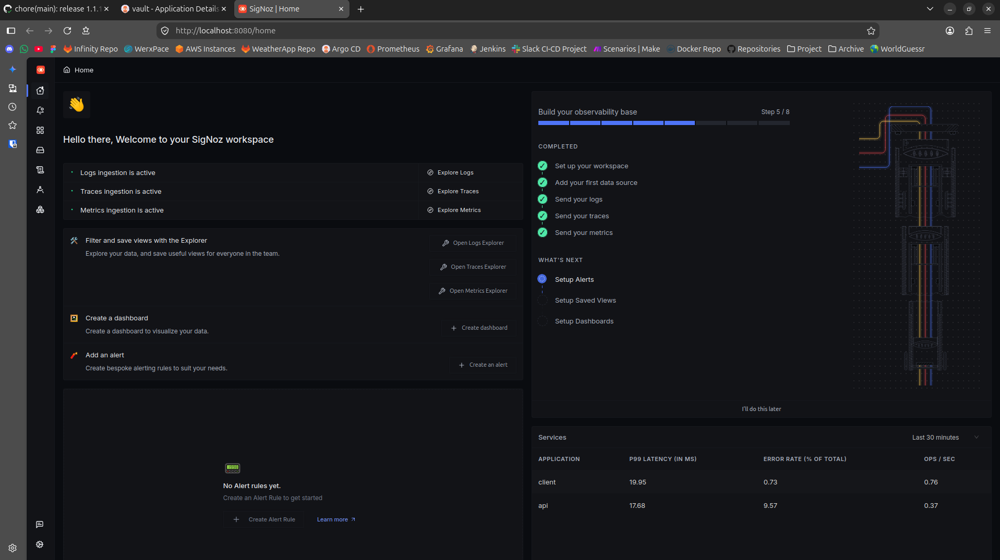 |
| Mongo fixed - all 4 buys were saved, none lost | 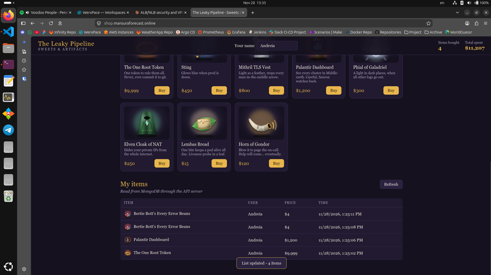 |
| SigNoz trace of one buy: client sent it at 13:25:11, api saved it ~10 minutes later (top: 9.95 mins). It waited in Kafka the whole time |  |

### 8. Tearing it down

`destroy.sh` removes what Kubernetes created (load balancer, disks), then runs `terraform destroy`. Nothing is left behind.

| | |
| --- | --- |
| 86 destroyed | 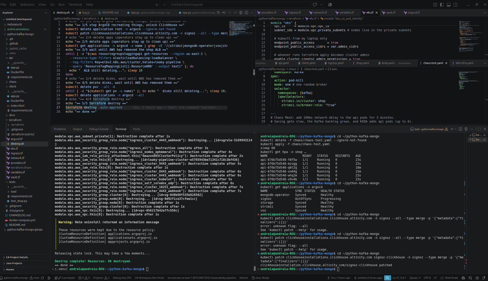 |
| AWS check: no VPC, cluster, nodes, disks or load balancers |  |

## CI/CD

Both pipelines run on **GitHub Actions** (`.github/workflows/`). GitHub Flow: every change goes through a pull request to `main`, which is protected. Commit messages follow Conventional Commits (`feat:`, `fix:`), which decide the next version.

**CI** - `ci.yml`, GitHub Actions, on every pull request. All 6 must pass to merge:

| Check | What |
| --- | --- |
| gitleaks | No secrets in the code or history |
| tests | pytest with real Kafka + Mongo in throwaway containers (Testcontainers) |
| codeql | Code security scan |
| images (api), images (client) | Build each image and scan it with Trivy |
| terraform-scan | Trivy scan of the Terraform |

**CD** - two halves:

| Half | Tool | What |
| --- | --- | --- |
| Delivery | GitHub Actions (`release.yml`, on every merge to `main`) | release-please opens a release PR (version + changelog). Merging it builds the images, pushes them to GHCR with the version tag, and writes the version into the GitOps repo |
| Deployment | ArgoCD (in the cluster) | Sees the new version in the GitOps repo and deploys it |

GitHub Actions never touches the cluster - it only writes to git, and ArgoCD pulls from git (pull model). So no cluster credentials live in GitHub.

## Tools and why

How I picked, in order: 1) the standard choice for the job, 2) covers a part of the lifecycle, 3) new to me - my previous project already used Prometheus/Grafana, Jenkins, GitLab CI and External Secrets.

<details>
<summary>Each tool vs the alternatives (15 areas)</summary>

| Area | Picked | Instead of | Why this one |
| --- | --- | --- | --- |
| Infra | Terraform | CloudFormation, CDK, Pulumi | Works on any cloud, and the official AWS VPC/EKS modules do most of the heavy lifting |
| Platform | EKS | ECS, plain EC2, self-run Kubernetes | Operators for Kafka/Mongo/Vault need Kubernetes; ECS has none. AWS runs the control plane, so I don't (see [Why run it in Kubernetes](#why-run-it-in-kubernetes)) |
| Deploy | ArgoCD | Flux, kubectl from CI | Pull model - no cluster credentials in CI. Its UI shows sync and health live, which Flux doesn't have built in |
| Kafka | Strimzi | Confluent operator, Bitnami chart, MSK | Free CNCF project; brokers and topics are plain Kubernetes objects. Confluent's operator is paid, Bitnami images moved behind a subscription, MSK costs more |
| Database | MongoDB operator (official) | Percona operator, Bitnami chart, DocumentDB | Made by MongoDB, free, real MongoDB 8.0. DocumentDB is only Mongo-compatible |
| Secrets | Vault + Vault Secrets Operator | Secrets Manager + External Secrets, Sealed Secrets | Vault generates the passwords itself - nobody types them, and they're never in git (Sealed Secrets still keeps them in git, encrypted). New to me; I'd used External Secrets before |
| Load balancer | AWS LB Controller + ExternalDNS | ingress-nginx | Real AWS ALB with the ACM certificate, no extra proxy pods. ingress-nginx was retired by Kubernetes in March 2026 |
| Scaling | KEDA | HPA on CPU | The real signal is orders waiting in Kafka. CPU stays low while orders pile up, so a CPU scaler reacts late |
| Monitoring | OpenTelemetry + SigNoz | Prometheus + Grafana + Loki + Tempo, Datadog, CloudWatch | One tool for logs, metrics and traces instead of four, all on the OpenTelemetry standard. Free, unlike Datadog. Grafana stack I'd already used |
| Integration tests | pytest + Testcontainers | Mocks, docker compose in CI | Tests run against real Kafka and Mongo, started and thrown away by the test itself |
| Load test | k6 | JMeter, Locust | The test is one short JS file run from one Docker image, with pass/fail thresholds built in. JMeter is XML and a GUI |
| Chaos | Chaos Mesh | LitmusChaos, AWS FIS | Experiments are short YAML files (kill a pod, add network delay). Litmus needs its own portal; FIS works at the AWS level, not per pod |
| Security | Gitleaks, CodeQL, Trivy | TruffleHog, SonarQube, Snyk | All free in GitHub Actions. Trivy alone covers both the images and the Terraform |
| CI/CD | GitHub Actions | Jenkins, GitLab CI | Code is already on GitHub, no CI server to run. Jenkins and GitLab I'd already used |
| Release | release-please + GHCR | semantic-release; ECR, Docker Hub | A release PR means a human approves each release - semantic-release releases straight away. GHCR sits next to the code, public images are free, no AWS keys in CI |

</details>

## Issues and fixes

The main ones (symptom -> cause -> fix):

- **MongoDB member stuck Pending** -> its helper container reserved 500m CPU by default and no node had room -> lowered it to 100m. The operator waited for all members before applying the change, so the stuck pod was patched and recreated once.
- **Destroy hung on SigNoz** -> its database (ClickHouse) has a lock that its operator keeps adding back -> the script removes it in a loop until SigNoz is gone.
- **MongoDB 8.0 crashes on new nodes** -> kernel 6.19+, and every apply took the newest node image -> image pinned (`ami_release_version` in `eks.tf`).
- **KEDA never scaled under load** -> the api was too fast for a backlog to build -> chaos test slows it down to show scaling.
- **SigNoz collectors wouldn't start** -> no organization existed -> admin user + org created at startup, password from Vault.
- **Trivy failed the images** -> old libraries inside pip itself -> pip removed from the final images.
- **Release PR didn't run CI** -> PRs made by the default GitHub token don't trigger workflows -> a personal token is used.

## What I'd add for production

- Vault TLS inside the cluster - today it's plain HTTP, which is OK only because it never leaves the private network.
- One NAT per AZ.
- Alert rules in SigNoz (the outage above was found by hand, not by an alert).
- An ArgoCD webhook instead of checking git every 3 minutes. ArgoCD isn't reachable from the internet today, so it can't receive one.
- Reserved CPU checked for every container - including the helpers that operators add.
