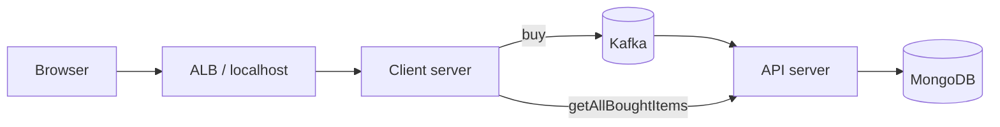
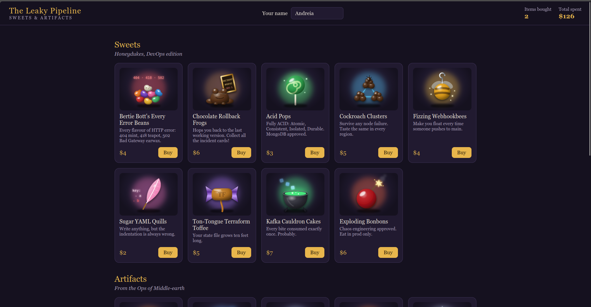
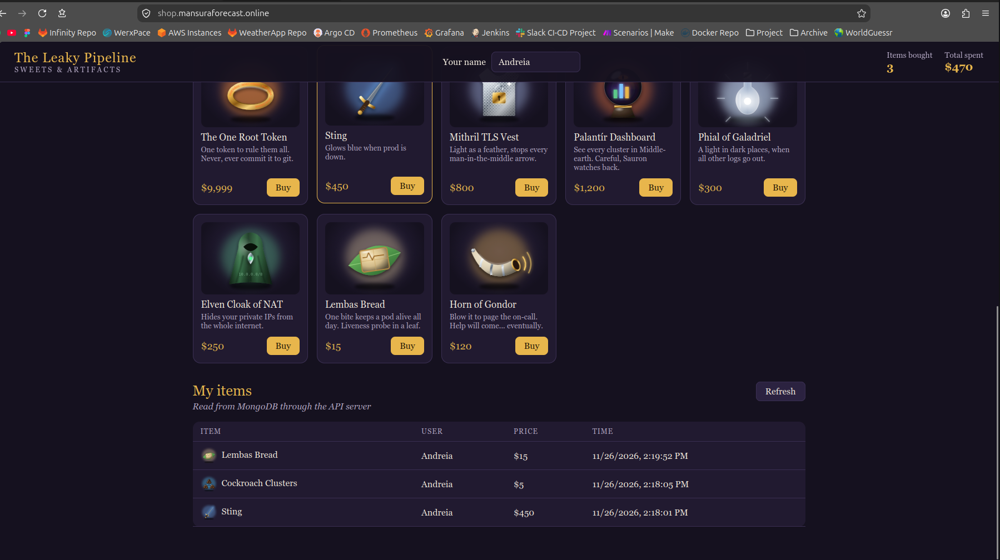
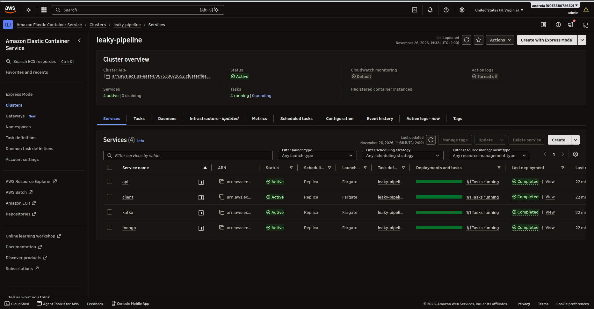
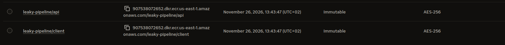
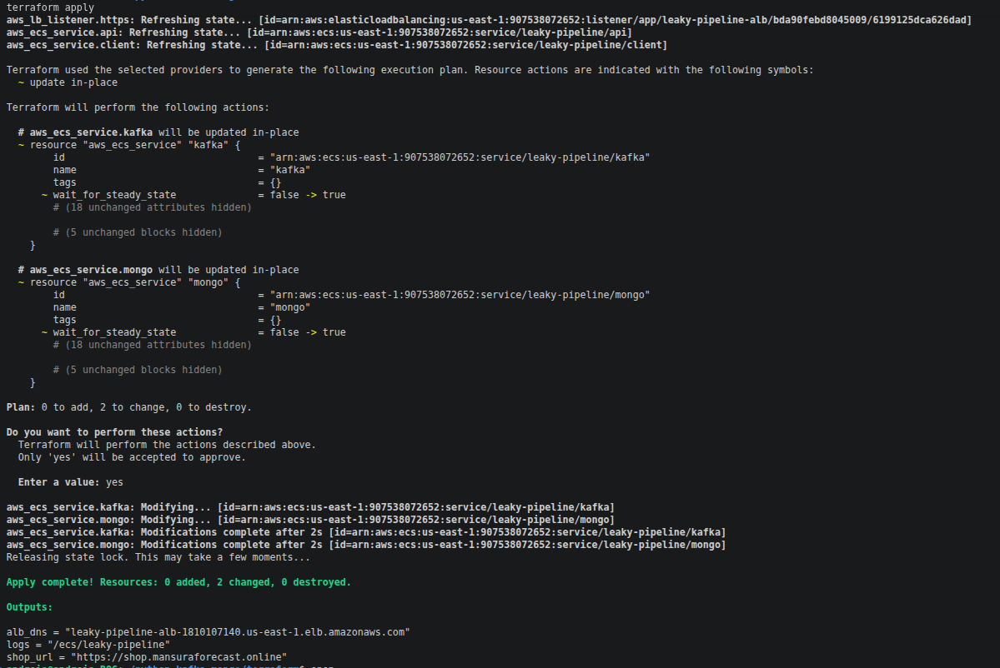

# Python, Kafka & MongoDB

Shop app for the Kafka/Mongo task. You buy something, it goes to Kafka, the API server saves it in Mongo, and the page shows everything bought. The shop is Harry Potter sweets and LOTR items with DevOps jokes, just for fun.

Runs locally with docker compose, and on AWS (ECS Fargate) with Terraform.

## Index

- [Python, Kafka \& MongoDB](#python-kafka--mongodb)
  - [Index](#index)
  - [How it works](#how-it-works)
  - [Running it](#running-it)
  - [Testing](#testing)
  - [Screenshots](#screenshots)
  - [Burndown](#burndown)
  - [Notes](#notes)

## How it works

The client server (FastAPI) serves the page, sends buys to Kafka and asks the API server for the list. The API server (FastAPI) reads Kafka in the background, saves to Mongo and returns the list.



## Running it

Locally:

```bash
docker compose up -d --build
```

Then open <http://localhost:8080>

On AWS:

```bash
cd terraform
terraform init
terraform apply -auto-approve     # ~3 min
terraform destroy -auto-approve
```

Then open <https://shop.mansuraforecast.online>

Terraform builds the VPC, an ALB with HTTPS, the DNS record, ECR (and builds/pushes the images), and the 4 containers on ECS Fargate. Only the ALB is public. The state bucket, DNS zone and cert were made once and aren't part of it.

## Testing

Stopped the API server, bought something, started it again. The buy waited in Kafka and got saved once the API was back (Horn of Gondor in the logs screenshot).

On AWS I did a full destroy + apply, bought an item right after and it showed up straight away. Checked after destroy that nothing was left.

## Screenshots

| What | Screenshot |
| --- | --- |
| Shop |  |
| API down |  |
| API logs after restart |  |
| List after restart |  |
| Shop on AWS |  |
| ECS services |  |
| ECR |  |
| Terraform apply |  |

## Burndown

| # | Task | Status |
| --- | --- | --- |
| 1 | Design + review | done |
| 2 | Compose: Kafka + Mongo | done |
| 3 | API + client servers | done |
| 4 | Frontend + theme | done |
| 5 | Testing | done |
| 6 | Terraform on AWS | done |
| 7 | Destroy/apply test | done |

## Notes

- Kafka in KRaft mode, no ZooKeeper
- Versions pinned everywhere
- At first the AWS shop took ~5 min to work after apply. Fixed by starting kafka and mongo before the API
- For real production: private subnets + NAT, MSK instead of Kafka in a container, DocumentDB for Mongo, images built in CI