# The Leaky Pipeline - Python, Kafka & MongoDB on EKS

A small shop (Harry Potter sweets + LOTR artifacts with DevOps jokes) used to show the full DevOps lifecycle: build, test, release, deploy, scale, break, monitor and tear down - all from git.

You buy something -> the **client** sends it to **Kafka** -> the **api** reads Kafka and saves it in **MongoDB** -> the page shows everything bought. If the api or the database is down, the order waits safely in Kafka and is saved once they're back.

Live (when the cluster is up): <https://shop.mansuraforecast.online>

## Index

- [How it works](#how-it-works)
- [The story in screenshots](#the-story-in-screenshots)
- [Running it](#running-it)
- [CI/CD](#cicd)
- [Tools and why](#tools-and-why)
- [Issues and fixes](#issues-and-fixes)
- [Notes](#notes)

## How it works

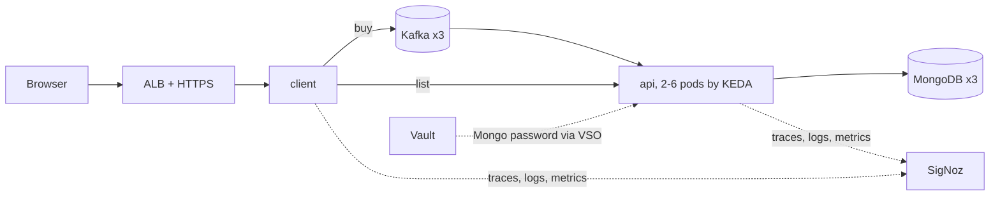

### AWS infrastructure

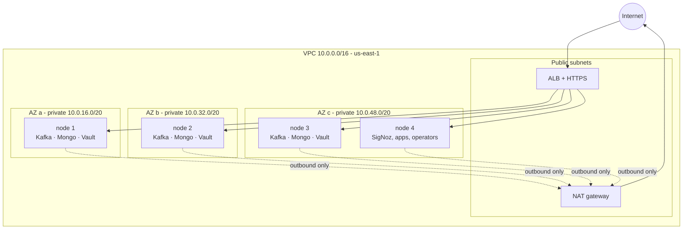

| | |
| --- | --- |
| VPC | 3 AZs. Public subnets (10.0.1-3.0/24) hold only the ALB and the NAT. Nodes and pods live in private subnets (/20 each - every pod gets a VPC IP) |
| NAT | One for all AZs - saves cost. Tradeoff: if its AZ goes down, nodes lose outbound internet (the shop keeps working) |
| Nodes | 4 x m7i-flex.large (2 vCPU / 8 GB) - the largest type on the AWS free plan. 32 GB total, ~24 GB used |
| Spread | Kafka, Mongo and Vault each run 3 copies, one per AZ. Losing an AZ still leaves 2 of 3 - a majority, so they keep working |
| EKS API | Public, but only reachable from my IP |

Node sizing (memory reserved, estimate):

| Node | Main pods | ~GB of 8 |
| --- | --- | --- |
| 1 | Kafka broker (2), Mongo (1), Vault, small pods | 5.4 |
| 2 | Kafka broker (2), Mongo (1), Vault, small pods | 6.1 |
| 3 | Kafka broker (2), Mongo (1), Vault, small pods | 6.4 |
| 4 | SigNoz + ClickHouse (~3), ArgoCD, operators, shop | 6.6 |

The exact pod placement is decided by Kubernetes at each build; the rule is one Kafka / Mongo / Vault per AZ.

### Repos

Two repos:

| Repo | Holds |
| --- | --- |
| `python-kafka-mongo` (this one) | App code, Dockerfiles, tests, CI/CD workflows, Terraform, load + chaos tests |
| `python-kafka-mongo-gitops` | What runs in the cluster: ArgoCD apps, Kafka/Mongo/Vault manifests, the shop Helm chart |

Terraform builds AWS (VPC, EKS, load balancer controller, DNS, KMS) and installs ArgoCD. ArgoCD then deploys everything else from the GitOps repo.

## The story in screenshots

### 1. It started on a laptop

The first version ran with docker compose. The api was stopped, a buy was made, and it waited in Kafka until the api came back.

| | |
| --- | --- |
| Shop |  |
| api down, buy still accepted | 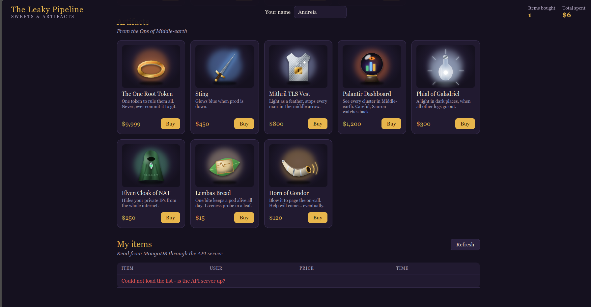 |
| api back, logs show the save |  |
| The buy is in the list |  |

### 2. One command builds AWS

`terraform apply` creates 86 resources. ArgoCD comes up and deploys all 15 apps from git - nothing installed by hand.

| | |
| --- | --- |
| Terraform apply | 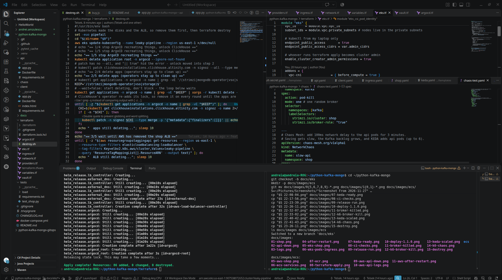 |
| ArgoCD: 15 apps, all healthy |  |

### 3. What got deployed

| | |
| --- | --- |
| The shop: deployed by the release bot, KEDA scaler, Ingress, Vault secret |  |
| Kafka: 2 small files -> Strimzi builds 3 brokers, 3 disks, the topic (+29 more objects) | 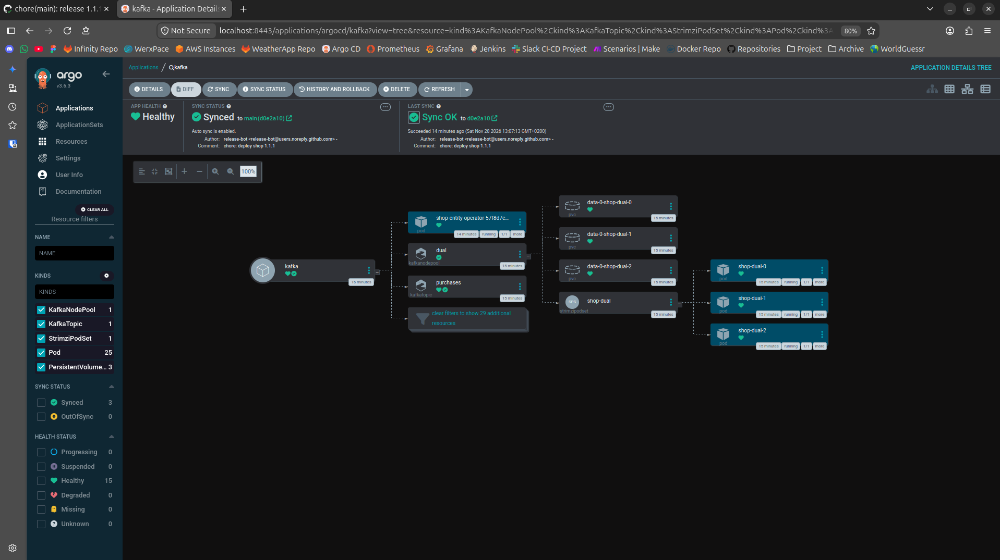 |
| Kafka network: clients connect to one address, 3 brokers behind it | 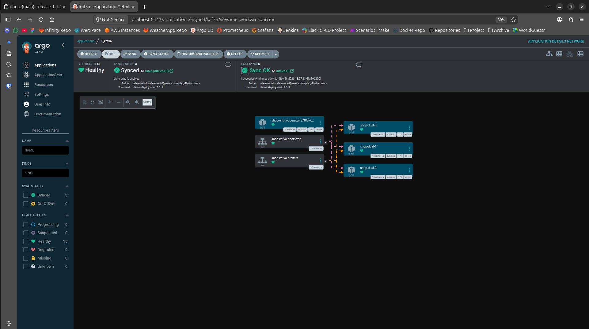 |
| The Kafka app's 4 pods (3 brokers + topic operator) spread one per node. Each node shows kernel 6.18 (pinned, see Notes) | 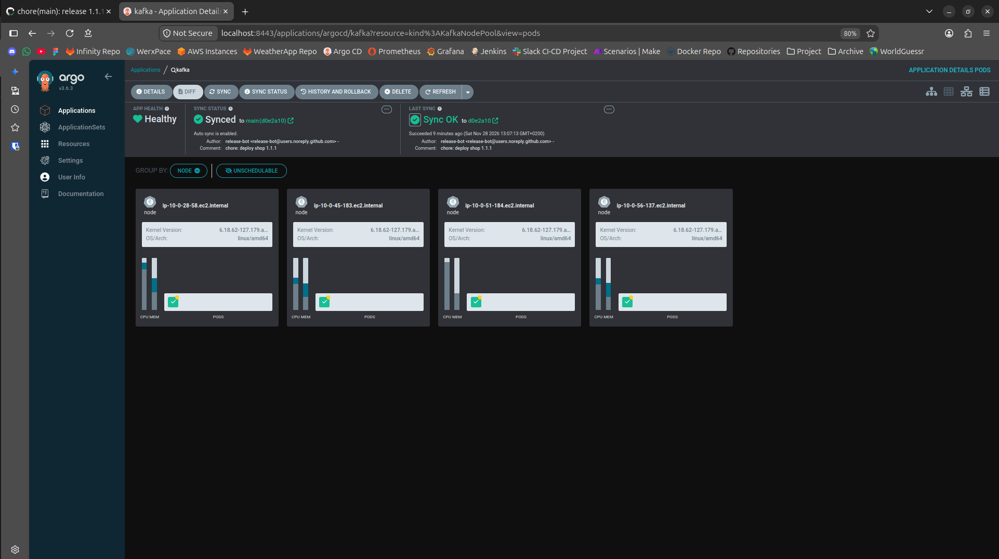 |
| Vault: 3 pods, 3 disks, active + standby |  |

### 4. It's live

| | |
| --- | --- |
| Shop on EKS |  |
| Pods + load balancer address |  |

### 5. Shipping a change

Every pull request must pass 6 checks. Merging a release builds the images, pushes them to GHCR and writes the new version into the GitOps repo - ArgoCD deploys it.

| | |
| --- | --- |
| 6 required checks | 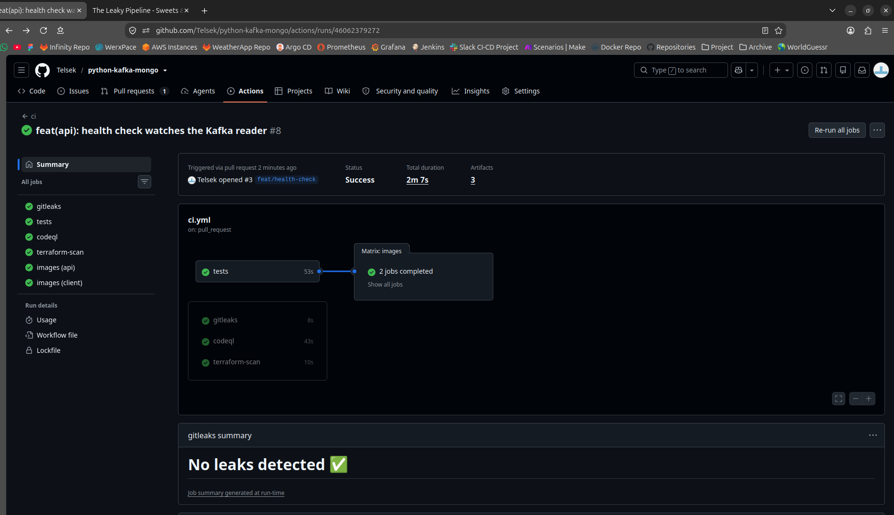 |
| Release: version -> images -> GitOps | 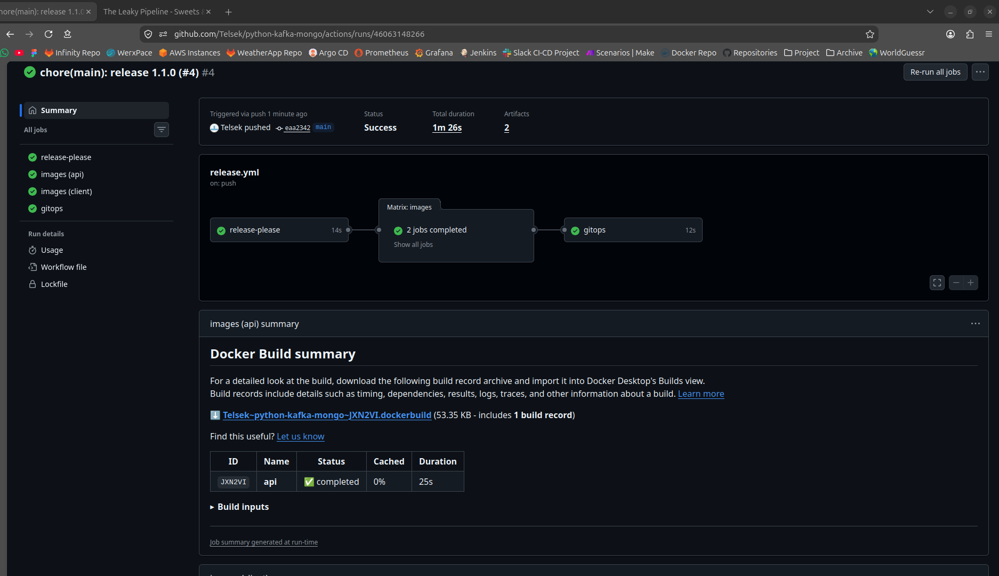 |

### 6. Breaking it on purpose

k6 sends ~170 buys per second for 3 minutes. Chaos Mesh kills a Kafka broker and slows the api down by 100 ms.

| | |
| --- | --- |
| A broker was killed and came back |  |
| Orders pile up in Kafka -> KEDA scales the api 2 -> 6 |  |
| 31,355 buys, 0 failed | 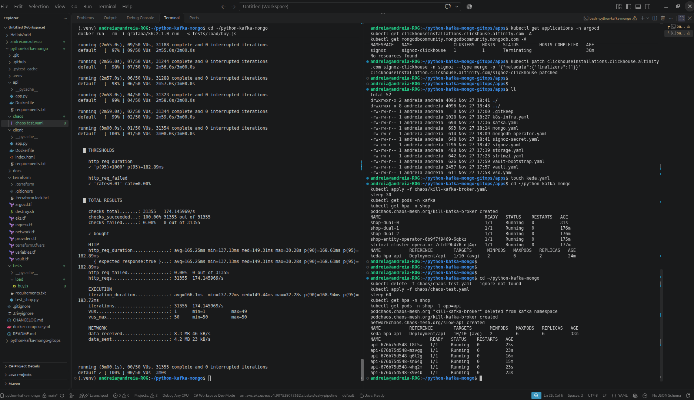 |

### 7. A real outage

After a rebuild, one MongoDB member couldn't start (not enough CPU reserved on any node). The api lost its database for about 10 minutes. 4 buys were made during that time.

| | |
| --- | --- |
| SigNoz home: logs, traces and metrics all active. Services table (bottom right): api error rate 9.57% - the failed "list" calls while Mongo was down |  |
| Mongo fixed - all 4 buys were saved, none lost |  |
| SigNoz trace of one buy: client sent it at 13:25:11, api saved it ~10 minutes later (top: 9.95 mins). It waited in Kafka the whole time | 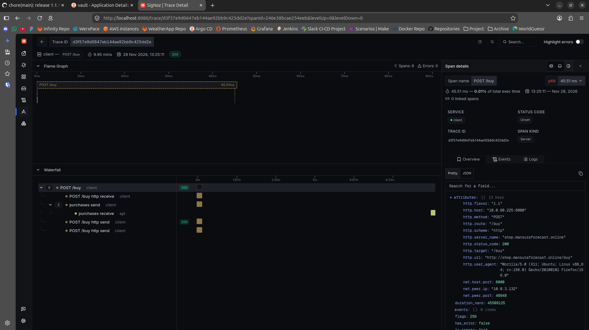 |

### 8. Tearing it down

`destroy.sh` removes what Kubernetes created (load balancer, disks), then runs `terraform destroy`. Nothing is left behind.

| | |
| --- | --- |
| 86 destroyed |  |
| AWS check: no VPC, cluster, nodes, disks or load balancers | 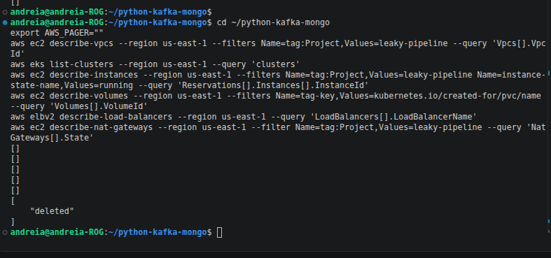 |

## Running it

Needs `terraform/terraform.tfvars` with `admin_cidrs = ["<your IP>/32"]`):

```bash
cd terraform
terraform init
terraform apply -auto-approve   # ~10 min, ArgoCD needs ~5 more
./destroy.sh                    # ~15 min
```

Why a destroy script and not just `terraform destroy`: the load balancer, DNS record and disks are created by Kubernetes controllers, not by Terraform. Terraform doesn't know they exist, and they block the VPC from being deleted. The script deletes the apps first, waits until AWS has removed those, then runs `terraform destroy`.

Load + chaos test (cluster up):

```bash
kubectl apply -f chaos/chaos-test.yaml
docker run --rm -i grafana/k6:2.1.0 run - < tests/load/buy.js
```

## CI/CD

Both pipelines run on **GitHub Actions** (`.github/workflows/`). GitHub Flow: every change goes through a pull request to `main`, which is protected. Commit messages follow Conventional Commits (`feat:`, `fix:`), which decide the next version.

**CI** - `ci.yml`, GitHub Actions, on every pull request. All 6 must pass to merge:

| Check | What |
| --- | --- |
| gitleaks | No secrets in the code or history |
| tests | pytest with real Kafka + Mongo in throwaway containers (Testcontainers) |
| codeql | Code security scan |
| images (api), images (client) | Build each image and scan it with Trivy |
| terraform-scan | Trivy scan of the Terraform |

**CD** - two halves:

| Half | Tool | What |
| --- | --- | --- |
| Delivery | GitHub Actions (`release.yml`, on every merge to `main`) | release-please opens a release PR (version + changelog). Merging it builds the images, pushes them to GHCR with the version tag, and writes the version into the GitOps repo |
| Deployment | ArgoCD (in the cluster) | Sees the new version in the GitOps repo and deploys it |

GitHub Actions never touches the cluster - it only writes to git, and ArgoCD pulls from git (pull model). So no cluster credentials live in GitHub.

## Tools and why

| Area | Tool | Why |
| --- | --- | --- |
| Infra | Terraform | Whole AWS setup in code, one command up and down |
| Platform | EKS (4 nodes, 3 AZs) | Kafka and Mongo clusters next to the apps, self-healing, scaling. Losing one AZ still leaves a majority |
| Deploy | ArgoCD (app of apps) | Git is the truth; the cluster matches it |
| Kafka | Strimzi | Runs a 3-broker Kafka from 2 small files |
| Database | MongoDB operator | 3-member replica set |
| Secrets | Vault + Vault Secrets Operator | Passwords generated by Vault, never in git. Vault unlocks itself with AWS KMS |
| Load balancer | AWS LB Controller + ExternalDNS | Ingress -> ALB with HTTPS, DNS record made automatically |
| Scaling | KEDA | Scales the api on Kafka backlog, not CPU |
| Monitoring | OpenTelemetry + SigNoz | Logs, metrics and traces in one place |
| Tests | pytest + Testcontainers, k6, Chaos Mesh | Real dependencies in tests, load, and failure testing |
| Security | Gitleaks, CodeQL, Trivy | Secrets, code and image/infra scanning |
| CI/CD | GitHub Actions | CI on every pull request, release on every merge |
| Release | release-please, GHCR | Versions and changelog from commit messages |

## Issues and fixes

The main ones (symptom -> cause -> fix):

- **MongoDB member stuck Pending** -> its helper container reserved 500m CPU by default and no node had room -> lowered it to 100m. The operator waited for all members before applying the change, so the stuck pod was patched and recreated once.
- **Destroy hung on SigNoz** -> its database (ClickHouse) has a lock that its operator keeps adding back -> the script removes it in a loop until SigNoz is gone.
- **MongoDB 8.0 crashes on new nodes** -> kernel 6.19+ -> node image pinned.
- **KEDA never scaled under load** -> the api was too fast for a backlog to build -> chaos test slows it down to show scaling.
- **SigNoz collectors wouldn't start** -> no organization existed -> admin user + org created at startup, password from Vault.
- **Trivy failed the images** -> old libraries inside pip itself -> pip removed from the final images.
- **Release PR didn't run CI** -> PRs made by the default GitHub token don't trigger workflows -> a personal token is used.

## Notes

- **Node image pinned** (`ami_release_version` in `eks.tf`): MongoDB 8.0 crashes on kernel 6.19+, and every apply would otherwise take the newest image.
- **Vault TLS is off inside the cluster** - traffic stays inside the private network. In production I'd turn it on.
- **EKS API is public but locked to my IP** (`admin_cidrs`), so kubectl works from my laptop. Trivy flags it; accepted in `.trivyignore` with the reason.
- **ArgoCD is not reachable from the internet** - it checks git every 3 minutes instead of using a webhook.
- **Free plan sizing:** largest allowed node is m7i-flex.large (2 vCPU / 8 GB). 4 nodes, ~24 GB of the 32 GB used.
- **Daily destroy:** the cluster is destroyed every evening and rebuilt from git when needed.
