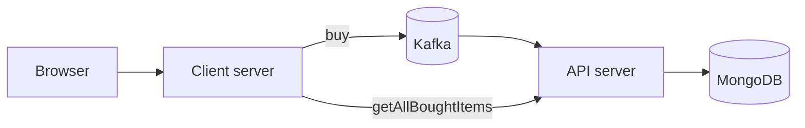

# Python, Kafka & MongoDB

Small shop app for the Kafka/Mongo task. You buy stuff on the page, the order goes to Kafka, the API server picks it up and saves it in Mongo, and you can see everything that was bought.

I made the shop Harry Potter sweets + LOTR items with DevOps jokes, just for fun.

## Index
- [Python, Kafka \& MongoDB](#python-kafka--mongodb)
  - [Index](#index)
  - [How it works](#how-it-works)
  - [Diagram](#diagram)
  - [Running it](#running-it)
  - [Testing](#testing)
  - [Screenshots](#screenshots)
  - [Burndown](#burndown)
  - [Notes](#notes)

## How it works
Frontend is one html page, served by the client server.

Client server (FastAPI) gets the buy from the page and sends it to Kafka, topic `purchases`. When the page asks for the list it calls the API server.

API server (FastAPI) reads from Kafka in the background and saves every order in Mongo (db `shop`, collection `purchases`). It also has `/getAllBoughtItems` that returns everything from Mongo.

## Diagram


## Running it
```bash
docker compose up -d --build
```
Then go to http://localhost:8080

Only the client is exposed (port 8080). Kafka, Mongo and the API are only reachable inside the compose network.

## Testing
Bought a few items and checked they show up in the list.

Then stopped the API server, bought something, and started it again:
```bash
docker compose stop api
docker compose start api
docker compose logs api | tail -5
```
While the API was down the list gave an error but buying still worked. When it came back up it saved the order that was waiting in Kafka (Horn of Gondor in the screenshot).

## Screenshots
Shop page


API stopped


API logs after starting it again


List after the restart


## Burndown
| # | Task | Status |
|---|---|---|
| 1 | Design + review with mentors | done |
| 2 | Kafka + Mongo in docker compose | done |
| 3 | API server | done |
| 4 | Client server | done |
| 5 | Frontend | done |
| 6 | Themed shop | done |
| 7 | Testing | done |
| 8 | README | done |

## Notes
- Kafka runs in KRaft mode so no ZooKeeper
- Image and package versions are pinned
- API server retries until Kafka is up, so start order doesn't matter
- Mongo data is in a volume so it stays after restarts